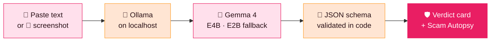

<div align="center">


# 🛡️ ScamShield

### Offline. Free. In your language.

**Paste a suspicious message. Get an honest verdict, with proof — in Hinglish, on your own laptop.**

<br/>


<br/>

[**✨ Features**](#-what-it-does) &nbsp;•&nbsp;
[**🚦 Verdicts**](#-three-honest-verdicts) &nbsp;•&nbsp;
[**🧬 Autopsy**](#-scam-autopsy) &nbsp;•&nbsp;
[**🧪 Demo**](#-try-it-yourself) &nbsp;•&nbsp;
[**⚙️ Architecture**](#%EF%B8%8F-how-it-works) &nbsp;•&nbsp;
[**🚀 Run**](#-run-it-locally) &nbsp;•&nbsp;
[**❓ FAQ**](#-faq) &nbsp;•&nbsp;
[**🗺️ Roadmap**](#%EF%B8%8F-roadmap)

</div>


## ⚡ At a glance

| | |
|---|---|
| 🎯 **What it does** | Tells you if a message is a **scam**, **suspicious** or **looks safe** — and shows the proof |
| 📥 **Input** | Pasted text **or** a screenshot |
| 📤 **Output** | A verdict card: verdict · quoted red flags · the trick · what to do |
| 🗣️ **Language** | **Hinglish** — explanations a grandmother can follow |
| 🧠 **Model** | **Gemma 4 E4B** (E2B as fast fallback), run locally via **Ollama** |
| 🌐 **Network** | **None needed.** Works with Wi-Fi off |
| 💸 **Cost** | **₹0** — no API key, no subscription, no per-check cost |
| 🔒 **Privacy** | Message stays on your machine; screenshots are downscaled and **never stored** |


## 📩 You have already got this message

Every one of these lands in Indian phones, every single day:

| | The message | The trick |
|:-:|---|---|
| 🏦 | *"Account blocked, KYC update karo, link par click karo."* | **Bank KYC blocked** |
| 📦 | *"Parcel held hai, sirf ₹49 fee pay karo aur release karo."* | **Courier parcel stuck** |
| 💼 | *"₹45,000 per month. Pehle ₹2,000 registration fee bhej do."* | **Dream job offer** |
| 👮 | *"Police bol rahe hain. Video call par aao, warna jail."* | **Digital arrest** |

<sub>All four are invented demo cases — and all four are painfully familiar.</sub>

## 💔 The real problem

> ### People do not fall for scams because they are careless.

They fall because **panic and greed leave no time to think** — and there is **no one to ask in the 10 seconds before they click.**

And the tools that exist make it worse:

| | ☁️ Cloud checkers | 🛡️ **ScamShield** |
|---|:-:|:-:|
| Needs internet | ❌ Yes | ✅ **No** |
| Uploads your private message | ❌ Yes, to someone else's server | ✅ **Never** |
| Cost per check | ❌ API / subscription | ✅ **Free** |
| Explains *why* | ⚠️ Often just a label | ✅ **Quotes proof from the message** |
| Language | ⚠️ Generic English | ✅ **Hinglish** |
| Teaches the family | ❌ No | ✅ **Scam Autopsy + one-tap warning** |


## ✨ What it does

**Paste a message or upload a screenshot.** ScamShield answers in **Hinglish**, with the **proof quoted from the message itself** — not just a label.

<div align="center">

</div>

### From panic to proof in three taps

<table>
<tr>
<td width="42%" valign="middle">

</td>
<td width="58%" valign="top">

**1️⃣ &nbsp;Paste or screenshot**
Drop the text in, or upload the screenshot. Gemma vision reads it for you.

**2️⃣ &nbsp;Get the verdict**
Scam, suspicious or looks safe — with every red flag **quoted word for word**.

**3️⃣ &nbsp;Know what to do**
The trick named in Hinglish, next steps made clear, and reporting on **1930**.

</td>
</tr>
</table>

## 🚦 Three honest verdicts

<table>
<tr>
<td width="33%" valign="top">

### 🔴 SCAM
Red flags quoted, trick named. **Stop and report.**

<sub>**Do not click · do not pay**</sub>

</td>
<td width="33%" valign="top">

### 🟠 SUSPICIOUS
Something is off, but it is not proven. **Slow down and verify.**

<sub>**When in doubt, this is the answer**</sub>

</td>
<td width="33%" valign="top">

### 🟢 LOOKS SAFE
Never "100% safe". Always added: **still verify in the official app.**

<sub>**Honest by design**</sub>

</td>
</tr>
</table>

> 💡 **Design rule:** ScamShield would rather say *"suspicious — verify"* than pretend to be certain. A false "safe" is the most expensive mistake it could make.

## 🧬 Scam Autopsy

> Detection stops **one** message. The Autopsy teaches the **whole playbook** — tap to reveal each layer, live.

| Layer | What it reveals |
|---|---|
| 🎭 **Who are they pretending to be?** | Bank, police, courier or company — **named out loud** |
| 🎯 **What do they want next?** | Your **OTP**, a **UPI payment**, a **remote-access app** or a **document** |
| 💬 **What if you reply?** | The **exact next line** they would use on you — **shown before they can use it** |
| 👨‍👩‍👧 **Warn the family in one tap** | *"Mummy, yeh message mat kholna, ismein yeh 3 jhooth hain."* |


## 🧪 Try it yourself

<table>
<tr>
<td width="56%" valign="top">

### 🎯 Pick a sample — no typing needed

| Built-in case | Expected verdict |
|---|:-:|
| 🏦 Bank KYC | 🔴 Scam |
| 📦 Courier fee | 🔴 Scam |
| 💼 Job offer | 🔴 Scam |
| 👮 Digital arrest | 🔴 Scam |
| ✅ Genuine-style alert | 🟢 Looks safe |
| ❓ Ambiguous delivery note | 🟠 Suspicious |

### 📴 The Wi-Fi-off moment
Turn the internet **off** and run the same check again.
**Same verdict. Nothing left this laptop.**

</td>
<td width="44%" valign="middle">

</td>
</tr>
</table>

<details>
<summary><b>🎬 60-second demo script (for judges &amp; reviewers)</b></summary>

<br/>

1. **Open the app** and pick the *Bank KYC* sample → expect 🔴 **Scam** with quoted flags.
2. **Open Scam Autopsy** and tap through each layer: impersonation → next ask → next line → family warning.
3. Pick the *Genuine-style alert* → expect 🟢 **Looks safe**, plus the reminder to verify in the official app.
4. Pick the *Ambiguous delivery note* → expect 🟠 **Suspicious**.
5. **Turn Wi-Fi off.** Re-run any sample. Same verdict, no cloud.
6. Upload a **screenshot** of a message → Gemma vision reads it, the same verdict engine judges it.

</details>


## 🌟 Why Gemma 4, why local, why now

<table>
<tr>
<td width="33%" valign="top">

#### 📴 Offline by design
Works with Wi-Fi off, in a village, in a dead-signal hall. **No cloud, no waiting.**

</td>
<td width="33%" valign="top">

#### 🔒 Private by design
A scam message holds your personal details. **It should never be uploaded anywhere.**

</td>
<td width="33%" valign="top">

#### 💸 Free for every family
Open weights via Ollama. **No API key, no subscription, no per-check cost.**

</td>
</tr>
<tr>
<td valign="top">

#### 🗣️ Speaks Hinglish
Explanations a grandmother can follow — **fear, greed and fake authority** named in her language.

</td>
<td valign="top">

#### 📸 Sees screenshots
Gemma vision reads the screenshot, then **the same verdict engine** judges it.

</td>
<td valign="top">

#### ⚖️ Verdict, not chat
A **fixed schema** — verdict, quoted flags, trick and action. **The model can never fake a result.**

</td>
</tr>
</table>

## ⚙️ How it works

**One laptop. Zero cloud.**



<table>
<tr>
<td width="55%" valign="top">

### 🧱 Design principles

| Principle | In practice |
|---|---|
| **Verdict, not chat** | Output is a **fixed schema**, validated in code — the model can't free-style a fake result |
| **One call per check** | Fast, simple, cheap on a laptop |
| **Fast fallback** | **E4B** by default, **E2B** when speed matters |
| **Proof over labels** | Red flags are **quoted word for word** |
| **Privacy by default** | Screenshots **downscaled, never stored** |
| **Honest uncertainty** | Never "100% safe"; *suspicious* is a valid answer |

</td>
<td width="45%" valign="middle">

</td>
</tr>
</table>

## 🚀 Run it locally

> ⚠️ **Fill in the placeholders** (`< >`) with your project's real values.

```bash
# 1 — Install Ollama  →  https://ollama.com
# 2 — Pull the Gemma 4 model
ollama pull <your-gemma-4-e4b-tag>
ollama pull <your-gemma-4-e2b-tag>     # optional: fast fallback

# 3 — Get ScamShield
git clone <your-repo-url>
cd scamshield

# 4 — Install & start
<install command>
<start command>
```

Open the app → pick a sample → **turn Wi-Fi off** → run it again. 🎉

<details>
<summary><b>📁 Project structure</b> <sub>(fill in)</sub></summary>

```text
scamshield/
├── <frontend>/        # UI: paste box, screenshot upload, verdict card, Autopsy
├── <backend>/         # calls Ollama, validates the JSON schema
├── <schema>/          # verdict · quoted flags · trick · action
├── <samples>/         # six built-in demo cases
└── README.md
```

</details>

## ❓ FAQ

<details>
<summary><b>Is my message uploaded anywhere?</b></summary>
<br/>No. The flow is Ollama on <code>localhost</code> → Gemma 4 → verdict card. There is no cloud call, and screenshots are downscaled and never stored.
</details>

<details>
<summary><b>Does it really work without internet?</b></summary>
<br/>Yes — that's the on-stage <i>Wi-Fi-off moment</i>. Same check, same verdict, nothing leaves the laptop.
</details>

<details>
<summary><b>Will it ever say a message is "100% safe"?</b></summary>
<br/>Never. A safe verdict always comes with: <i>still verify in the official app</i>.
</details>

<details>
<summary><b>Why Hinglish?</b></summary>
<br/>Because scams arrive in Hinglish — "KYC update karo", "fee pay karo" — and the explanation should be in words the whole family understands, grandmother included.
</details>

<details>
<summary><b>Can the model make up a verdict?</b></summary>
<br/>No. Output is a fixed schema (verdict, quoted flags, trick, action) validated in code, so an off-format answer never reaches the verdict card.
</details>

<details>
<summary><b>Does it run on my phone?</b></summary>
<br/>Not yet. Today the <b>laptop demo is the truth</b>; on-device Gemma E2B on the phone is on the roadmap, reusing the same schema and prompts.
</details>


## 🗺️ Roadmap

An honest one.

- [x] 💻 **Laptop demo** — paste / screenshot → Ollama → Gemma 4 → verdict card
- [x] 🚦 **Three honest verdicts** with quoted red flags
- [x] 🧬 **Scam Autopsy** — the whole playbook, layer by layer
- [x] 🗣️ **Hinglish explanations** + one-tap family warning
- [x] 🧪 **Six built-in samples** for no-typing demos
- [ ] 📱 **On-device Gemma E2B** — same schema and prompts, on the phone

> **Today, the laptop demo is the truth.**

## ⚠️ Honest limits

ScamShield is a **decision aid, not an oracle**. A *looks safe* verdict is never a guarantee — always confirm through the official app or website of the bank, courier or company. When in doubt, the right answer is **suspicious**.

## 🚨 If you think you've been scammed

<div align="center">

# 📞 Report on **1930**

### Do not click. Do not pay. Report.

</div>

## 🤝 Contributing &amp; license

Contributions, new scam patterns and Hinglish phrasing improvements are welcome — open an issue or a PR. <br/>
**License:** `<your license>` &nbsp;·&nbsp; **Author:** `<your name>`


<div align="center">

**ScamShield does not just catch one scam.**
**It teaches a whole family how scams work — before the next message arrives.** 🛡️

<sub>Made with ❤️ for every family that has ever got *that* message.</sub>

</div>
