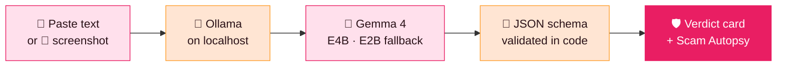

<div align="center">

# 🛡️ ScamShield

### MODE=local: offline. Honest verdicts. In your language.

**Paste a suspicious message. Get an honest verdict, with proof — in Hinglish, on your own laptop.**

<br/>


<br/>

[**✨ Features**](#-what-it-does) &nbsp;•&nbsp;
[**🚦 Verdicts**](#-three-honest-verdicts) &nbsp;•&nbsp;
[**🧬 Autopsy**](#-scam-autopsy) &nbsp;•&nbsp;
[**🧪 Demo**](#-try-it-yourself) &nbsp;•&nbsp;
[**⚙️ Architecture**](#%EF%B8%8F-how-it-works) &nbsp;•&nbsp;
[**🚀 Run**](#-run-it-locally) &nbsp;•&nbsp;
[**❓ FAQ**](#-faq) &nbsp;•&nbsp;
[**🗺️ Roadmap**](#%EF%B8%8F-roadmap)

</div>

---

## ⚡ At a glance

| | |
|---|---|
| 🎯 **What it does** | Tells you if a message is a **scam**, **suspicious** or **looks safe** — and shows the proof |
| 📥 **Input** | Pasted text **or** a screenshot |
| 📤 **Output** | A verdict card: verdict · quoted red flags · the trick · what to do |
| 🗣️ **Language** | **Hinglish** — explanations a grandmother can follow |
| 🧠 **Model** | **MODE=local:** Gemma 4 E4B (E2B fast fallback) via **Ollama** · **MODE=api:** **gemma-4-26b-a4b-it** via **Gemini API** |
| 🌐 **Network** | **MODE=local: none needed** — works with Wi-Fi off · **MODE=api:** one Gemini API call to get the verdict |
| 💸 **Cost** | **MODE=local: ₹0** — no API key, no subscription, no per-check cost · **MODE=api:** Google AI Studio quota |
| 🔒 **Privacy** | **MODE=local:** message never leaves your machine · **MODE=api:** message is sent **only** to get the verdict, **never stored, never logged** · screenshots downscaled, never stored |

---

## 📩 You have already got this message

Every one of these lands in Indian phones, every single day:

| | The message | The trick |
|:-:|---|---|
| 🏦 | *"Account blocked, KYC update karo, link par click karo."* | **Bank KYC blocked** |
| 📦 | *"Parcel held hai, sirf ₹49 fee pay karo aur release karo."* | **Courier parcel stuck** |
| 💼 | *"₹45,000 per month. Pehle ₹2,000 registration fee bhej do."* | **Dream job offer** |
| 👮 | *"Police bol rahe hain. Video call par aao, warna jail."* | **Digital arrest** |

<sub>All four are invented demo cases — and all four are painfully familiar.</sub>

## 💔 The real problem

> ### People do not fall for scams because they are careless.

They fall because **panic and greed leave no time to think** — and there is **no one to ask in the 10 seconds before they click.**

And the tools that exist make it worse:

| | ☁️ Cloud checkers | 🛡️ **ScamShield** |
|---|:-:|:-:|
| Needs internet | ❌ Yes | ✅ **No in MODE=local** (MODE=api needs the verdict call) |
| Uploads your private message | ❌ Yes, to someone else's server | ✅ **Never stored** — in MODE=local it never leaves the device at all |
| Cost per check | ❌ API / subscription | ✅ **Free** |
| Explains *why* | ⚠️ Often just a label | ✅ **Quotes proof from the message** |
| Language | ⚠️ Generic English | ✅ **Hinglish** |
| Teaches the family | ❌ No | ✅ **Scam Autopsy + one-tap warning** |

---

## ✨ What it does

**Paste a message or upload a screenshot.** ScamShield answers in **Hinglish**, with the **proof quoted from the message itself** — not just a label.

### From panic to proof in three taps

**1️⃣ &nbsp;Paste or screenshot**
Drop the text in, or upload the screenshot. Gemma vision reads it for you.

**2️⃣ &nbsp;Get the verdict**
Scam, suspicious or looks safe — with every red flag **quoted word for word**.

**3️⃣ &nbsp;Know what to do**
The trick named in Hinglish, next steps made clear, and reporting on **1930**.

## 🚦 Three honest verdicts

<table>
<tr>
<td width="33%" valign="top">

### 🔴 SCAM
Red flags quoted, trick named. **Stop and report.**

<sub>**Do not click · do not pay**</sub>

</td>
<td width="33%" valign="top">

### 🟠 SUSPICIOUS
Something is off, but it is not proven. **Slow down and verify.**

<sub>**When in doubt, this is the answer**</sub>

</td>
<td width="33%" valign="top">

### 🟢 LOOKS SAFE
Never "100% safe". Always added: **still verify in the official app.**

<sub>**Honest by design**</sub>

</td>
</tr>
</table>

> 💡 **Design rule:** ScamShield would rather say *"suspicious — verify"* than pretend to be certain. A false "safe" is the most expensive mistake it could make.

## 🧬 Scam Autopsy

> Detection stops **one** message. The Autopsy teaches the **whole playbook** — tap to reveal each layer, live.

| Layer | What it reveals |
|---|---|
| 🎭 **Who are they pretending to be?** | Bank, police, courier or company — **named out loud** |
| 🎯 **What do they want next?** | Your **OTP**, a **UPI payment**, a **remote-access app** or a **document** |
| 💬 **What if you reply?** | The **exact next line** they would use on you — **shown before they can use it** |
| 👨‍👩‍👧 **Warn the family in one tap** | *"Mummy, yeh message mat kholna, ismein yeh 3 jhooth hain."* |

---

## 🧪 Try it yourself

### 🎯 Pick a sample — no typing needed

| Built-in case | Expected verdict |
|---|:-:|
| 🏦 Bank KYC | 🔴 Scam |
| 📦 Courier fee | 🔴 Scam |
| 💼 Job offer | 🔴 Scam |
| 👮 Digital arrest | 🔴 Scam |
| ✅ Genuine-style alert | 🟢 Looks safe |
| ❓ Ambiguous delivery note | 🟠 Suspicious |

### 📴 The Wi-Fi-off moment (MODE=local)
Turn the internet **off** and run the same check again.
**Same verdict. Nothing left this laptop.** (MODE=api needs the internet for the Gemini API verdict call.)

<details>
<summary><b>🎬 60-second demo script (for judges &amp; reviewers)</b></summary>

<br/>

1. **Open the app** and pick the *Bank KYC* sample → expect 🔴 **Scam** with quoted flags.
2. **Open Scam Autopsy** and tap through each layer: impersonation → next ask → next line → family warning.
3. Pick the *Genuine-style alert* → expect 🟢 **Looks safe**, plus the reminder to verify in the official app.
4. Pick the *Ambiguous delivery note* → expect 🟠 **Suspicious**.
5. **Turn Wi-Fi off.** Re-run any sample (MODE=local). Same verdict, no cloud.
6. Upload a **screenshot** of a message → Gemma vision reads it, the same verdict engine judges it.

</details>

---

## 🌟 Why Gemma 4, why local, why now

<table>
<tr>
<td width="33%" valign="top">

#### 📴 Offline by design (MODE=local)
Works with Wi-Fi off, in a village, in a dead-signal hall. **No cloud, no waiting.**

</td>
<td width="33%" valign="top">

#### 🔒 Private by design
A scam message holds your personal details. **It should never be uploaded anywhere.**

</td>
<td width="33%" valign="top">

#### 💸 Free for every family (MODE=local)
Open weights via Ollama. **No API key, no subscription, no per-check cost.**

</td>
</tr>
<tr>
<td valign="top">

#### 🗣️ Speaks Hinglish
Explanations a grandmother can follow — **fear, greed and fake authority** named in her language.

</td>
<td valign="top">

#### 📸 Sees screenshots
Gemma vision reads the screenshot, then **the same verdict engine** judges it.

</td>
<td valign="top">

#### ⚖️ Verdict, not chat
A **fixed schema** — verdict, quoted flags, trick and action. Off-schema or unproven answers are **demoted to SUSPICIOUS**, never shown as certain.

</td>
</tr>
</table>

## ⚙️ How it works

> ### 🔌 Two honest modes — read this first
>
> | Mode | What honestly happens |
> |---|---|
> | **MODE=local** (Ollama, offline demo) | The message **never leaves the device** — Ollama + Gemma run on `localhost:11434`. Works with Wi-Fi off, ₹0, no key. |
> | **MODE=api** (Gemini API backend) | The message **is sent to the Gemini API** (`gemma-4-26b-a4b-it`) **only to get the verdict** — it is **never stored, never logged**, and the key never leaves the backend `.env`. |
>
> The offline / free / nothing-leaves-the-device claims on this page are **true for MODE=local only**. In MODE=api the message must reach the Gemini API to be judged — we say that plainly.

**MODE=local: one laptop, zero cloud.**



### 🧱 Design principles

| Principle | In practice |
|---|---|
| **Verdict, not chat** | Output is a **fixed schema**, validated in code — unproven answers become **SUSPICIOUS** |
| **One call per check** | Fast, simple, cheap on a laptop |
| **Fast fallback** | **E4B** by default, **E2B** when speed matters |
| **Proof over labels** | Red flags are **quoted word for word** |
| **Privacy by default** | Screenshots **downscaled, never stored** · MODE=local: nothing leaves the device |
| **Honest uncertainty** | Never "100% safe"; *suspicious* is a valid answer |

## 🚀 Run it locally

Zero npm dependencies — Node ≥ 18 is enough.

```bash
# 1 — Install Ollama  →  https://ollama.com
ollama pull gemma4:e4b        # MODE=local primary model
ollama pull gemma4:e2b        # optional: fast fallback

# 2 — Get ScamShield
git clone https://github.com/spartanfromk-18/Project-777.git
cd Project-777

# 3 — MODE=local (offline, no key): backend runs on the local Ollama
MODE=local npm start          # → http://localhost:3000   (Wi-Fi off bhi same verdict)

# 3b — MODE=api (Gemini API): copy the template and put YOUR key in .env
cp .env.example .env          # .env is gitignored — key kabhi git me nahi jayegi
npm start                     # → http://localhost:3000
```

Tests:

```bash
npm test                       # 32 keyless mock-pipeline tests — validation, repair, fallbacks, adapter
npm run test:golden            # LIVE golden run — real Gemini engine only; key missing = honest BLOCK
```

Open the app → pick a sample → **turn Wi-Fi off** (MODE=local) → run it again. 🎉

<details>
<summary><b>📁 Project structure</b></summary>

```text
Project-777/
├── app.js              # window.ScamShield adapter — backend mode (POST /api/check) + offline file:// mode (direct Ollama)
├── server.js           # zero-dependency backend: /api/check, /api/status, rate limit, CORS
├── api/                # check.js (pipeline) · validate.js (SPEC v1.0) · gemini.js · ollama.js · engines/mock.js (TEST-ONLY)
├── tests/              # mock.test.mjs (32 keyless tests) · golden.mjs (live golden run) · golden-cases.js (8 binding cases)
├── .env.example        # GEMINI_API_KEY + MODE template (.env itself is gitignored)
└── README.md
```

</details>

## ❓ FAQ

<details>
<summary><b>Is my message uploaded anywhere?</b></summary>
<br/><b>MODE=local:</b> No — the flow is Ollama on <code>localhost</code> → Gemma 4 → verdict card; nothing leaves the device. <b>MODE=api:</b> the message is sent to the Gemini API <i>only to get the verdict</i> — never stored, never logged, and the key stays in the backend's <code>.env</code>. Screenshots are downscaled and never stored in both modes.
</details>

<details>
<summary><b>Does it really work without internet?</b></summary>
<br/>In <b>MODE=local</b>, yes — that's the on-stage <i>Wi-Fi-off moment</i>. Same check, same verdict, nothing leaves the laptop. <b>MODE=api</b> needs the internet for the Gemini API verdict call.
</details>

<details>
<summary><b>Will it ever say a message is "100% safe"?</b></summary>
<br/>Never. A safe verdict always comes with: <i>still verify in the official app</i>.
</details>

<details>
<summary><b>Why Hinglish?</b></summary>
<br/>Because scams arrive in Hinglish — "KYC update karo", "fee pay karo" — and the explanation should be in words the whole family understands, grandmother included.
</details>

<details>
<summary><b>Can the model make up a verdict?</b></summary>
<br/>It can't fake certainty. Output is a fixed schema (verdict, quoted flags, trick, action) validated in code: off-format, unproven or mixed-signal answers are demoted to SUSPICIOUS, and a "safe" verdict always keeps a <i>verify in the official app</i> step.
</details>

<details>
<summary><b>Does it run on my phone?</b></summary>
<br/>Not yet. Today the <b>laptop demo is the truth</b>; on-device Gemma E2B on the phone is on the roadmap, reusing the same schema and prompts.
</details>

---

## 🗺️ Roadmap

An honest one.

- [x] 💻 **Laptop demo** — paste / screenshot → Ollama → Gemma 4 → verdict card
- [x] 🚦 **Three honest verdicts** with quoted red flags
- [x] 🧬 **Scam Autopsy** — the whole playbook, layer by layer
- [x] 🗣️ **Hinglish explanations** + one-tap family warning
- [x] 🧪 **Eight built-in samples** — 6 core + Hinglish + Devanagari, for no-typing demos
- [ ] 📱 **On-device Gemma E2B** — same schema and prompts, on the phone

> **Today, the laptop demo is the truth.**

## ⚠️ Honest limits

ScamShield is a **decision aid, not an oracle**. A *looks safe* verdict is never a guarantee — always confirm through the official app or website of the bank, courier or company. When in doubt, the right answer is **suspicious**.

## 🚨 If you think you've been scammed

<div align="center">

# 📞 Report on **1930**

### Do not click. Do not pay. Report.

</div>

## 🤝 Contributing &amp; license

Contributions, new scam patterns and Hinglish phrasing improvements are welcome — open an issue or a PR. <br/>
**License:** MIT — see [LICENSE](LICENSE)

---

<div align="center">

**ScamShield does not just catch one scam.**
**It teaches a whole family how scams work — before the next message arrives.** 🛡️

<sub>Made with ❤️ for every family that has ever got *that* message.</sub>

</div>
